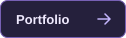
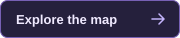
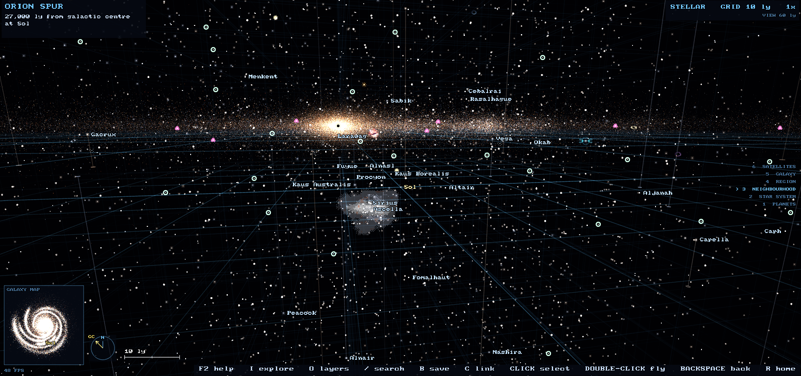
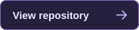
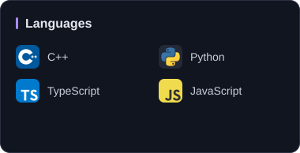
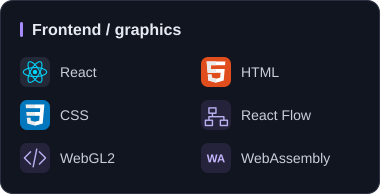
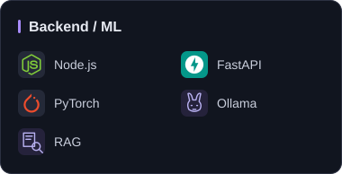
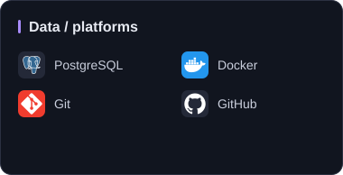

  

Just trying to code stuff and figure things out along the way.

  
  

## Selected work

Interactive graphics and local AI, built into things you can use.

<table width="100%">
<tr><td>
INTERACTIVE GRAPHICS
<h3>Milky Way Star Map</h3>

<strong>A browser-based window into our stellar neighbourhood.</strong>

Explore stars, exoplanets and nebulae. HYG and Gaia star positions meet a procedural galaxy field, powered by a C++ renderer in the browser.

<code>C++</code> <code>WebAssembly</code> <code>WebGL2</code>

</td></tr>
</table>

<table width="100%">
<tr><td>
FEATURED BUILD · LOCAL AI
<h3>GoodFlow</h3>

<strong>From workflow screenshot to editable diagram. All locally.</strong>

Qwen2.5-VL through Ollama turns images into a React Flow canvas with synchronized Mermaid, automatic layout, and Mermaid, SVG, PNG or JSON export. No cloud inference required.

<code>React</code> <code>TypeScript</code> <code>FastAPI</code> <code>Ollama</code>

Illustrated workflow, not an application screenshot.

</td></tr>
</table>

## Things I work with

The toolkit behind the projects, grouped by what it does.

  
  

  
  

