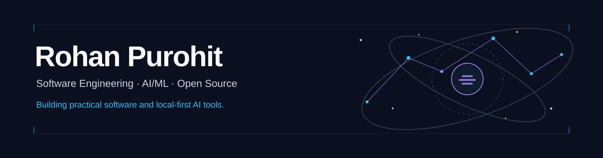

  

I'm **Rohan Purohit**, a Computer Science engineer building software across interactive graphics, full-stack applications, and computer vision. I like making complex systems tangible, whether that's a map of the Milky Way or a tool for editing diagrams. I hold a **B.E. in Computer Science** from Thapar Institute of Engineering & Technology.

[Explore the Galaxy](https://star-map-three.vercel.app) · [Portfolio](https://rohan-purohit.vercel.app)

## Featured projects

### [Milky Way Star Map](https://star-map-three.vercel.app)

An interactive, true-scale 3D map of the Milky Way built with C++, WebGL2, and WebAssembly. Explore observed stars alongside exoplanets, star clusters, nebulae, and black holes; search for objects and travel between them in the browser. [Explore the map](https://star-map-three.vercel.app) · [Source code](https://github.com/ARPurohit07/milky-way-star-map)

`C++` · `WebGL2` · `WebAssembly` · `Astronomical catalogues`

### [GoodFlow](https://github.com/ARPurohit07/GoodFlow)

Convert workflow images into editable diagrams, free and local-first. GoodFlow uses a vision-language model through Ollama to turn PNG/JPG diagrams into graphs you can edit on a canvas or as Mermaid text, then export in multiple formats.

`TypeScript` · `React` · `React Flow` · `FastAPI` · `Ollama` · `Mermaid` · `ELK`

## Experience

**Bayer Pharmaceuticals — Software Development Intern** 
Worked on clinical imaging workflow software, extending the OHIF viewer to help reviewers inspect multiple imaging modalities and timepoints in one workflow. Contributed to review features and bug fixes across React, TypeScript, and related services.

**Bharat Electronics Limited — Computer Vision Intern** 
Worked on a drone-detection prototype using Faster R-CNN with a ResNet-50 backbone in PyTorch, including image preparation, bounding-box labels, augmentation, and evaluation.

## Tools and technologies

| Area | Tools |
| --- | --- |
| Languages | C++, Python, TypeScript, JavaScript, SQL |
| Frontend | React, React Flow, HTML, CSS |
| Backend | FastAPI, Node.js, REST APIs |
| Graphics and AI | WebGL2, WebAssembly, PyTorch, Faster R-CNN, vision-language models |
| Data and tools | PostgreSQL, Docker, Git, Ollama |

I'm interested in interactive visualization, open-source developer tools, local-first AI, and computer vision. I'm open to full-time software engineering and relevant AI/ML opportunities in India or remotely from India.

[Portfolio](https://rohan-purohit.vercel.app) · [GitHub](https://github.com/ARPurohit07)
