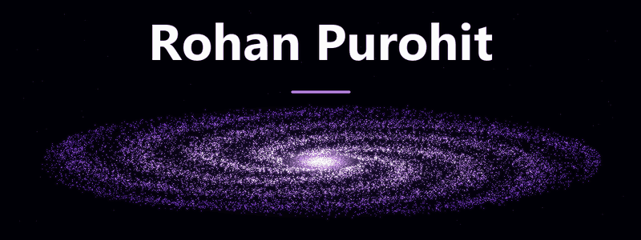
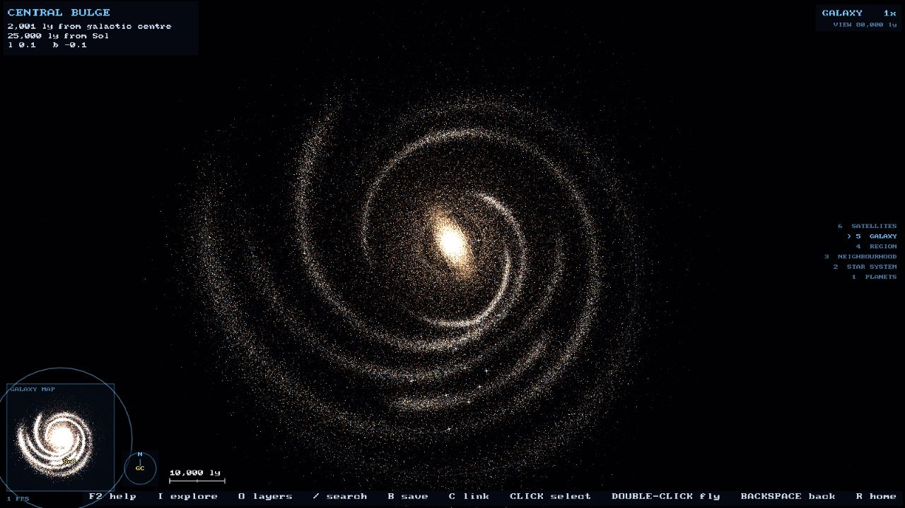

  

  Just trying to code stuff and figure things out along the way.

  <a href="https://rohan-purohit.vercel.app">Portfolio</a> &nbsp; · &nbsp;
  <a href="https://linkedin.com/in/rohan-purohit-b65062277">LinkedIn</a>

 

<h2 align="center">Selected work</h2>

<h3 align="center">Milky Way Star Map</h3>

  Explore stars, exoplanets, nebulae, and clusters. 
  Search for an object, find your way around, and share the view.

  A <strong>C++ renderer brought to the browser with WebAssembly and WebGL2</strong>. 
  Stellar positions draw on HYG and Gaia; a procedural field supplies the galaxy's overall structure.

  <a href="https://star-map-three.vercel.app">Explore the map</a>

  

 

<h3 align="center">GoodFlow</h3>

  Turn workflow screenshots into editable diagrams with <strong>Qwen2.5-VL through Ollama</strong>. 
  A React Flow canvas, synchronized Mermaid text, automatic layout, and multiple export formats.

  <strong>React · TypeScript · Python · FastAPI</strong>

  <a href="https://github.com/ARPurohit07/GoodFlow">View repository</a>

   
  Workflow illustration, not an application screenshot.

 

<h2 align="center">Things I work with</h2>

  

  C++ · Python · TypeScript · JavaScript · React · HTML · CSS

  

  Node.js · FastAPI · PyTorch · PostgreSQL · Docker · Git · GitHub

  WebAssembly · WebGL2 · Ollama · React Flow · RAG

