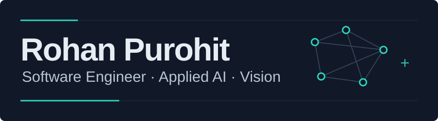
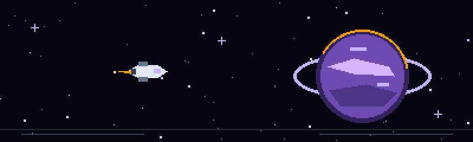

I build practical software and local-first AI tools, with a focus on making complex workflows and data easier to use.

  
  
  

## Featured work

### [GoodFlow](https://github.com/ARPurohit07/GoodFlow)

GoodFlow turns workflow images into editable diagrams with a local vision-language model. Edit the graph visually or as Mermaid, then export it. Built with React, TypeScript, FastAPI, Ollama, and Qwen2.5-VL.

### [Milky Way Star Map](https://star-map-three.vercel.app)

Explore the Milky Way in a true-scale 3D browser map built with C++, WebGL2, and WebAssembly. The map draws on astronomical catalogues for stars, exoplanets, nebulae, and clusters.

[Explore the map](https://star-map-three.vercel.app) · [Source code](https://github.com/ARPurohit07/milky-way-star-map)

## Technologies

**Languages** 

**Frameworks and UI** 

**AI and developer tools** 

B.E. in Computer Science. Open to software engineering and applied AI opportunities. [Explore my work](https://rohan-purohit.vercel.app).
