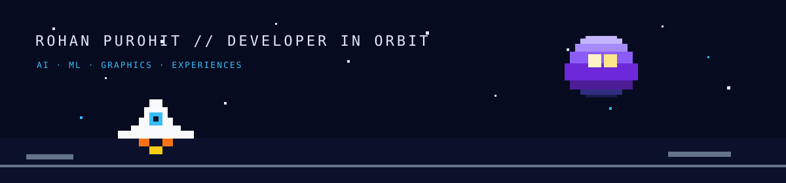

<div align="center">



# `ARPurohit07` // ROHAN PUROHIT

### AI/ML builder · creative coder · explorer of digital galaxies

<a href="https://rohan-purohit.vercel.app"></a>
<a href="https://star-map-three.vercel.app"></a>
<a href="https://github.com/ARPurohit07"></a>

</div>

<br />

```text
╭──────────────────────────────────────────────────────────────────────╮
│  > booting rohan.exe                                                │
│  [████████████████████████████████████████] 100%                    │
│                                                                      │
│  I build intelligent systems, immersive interfaces, and tools that  │
│  make complex ideas feel a little more human.                       │
╰──────────────────────────────────────────────────────────────────────╯
```

## `STATUS.LOG`

- 🚀 Currently building with **AI, machine learning, data, and graphics**
- 🌌 Creator of the [Milky Way Star Map](https://star-map-three.vercel.app), an interactive 3D universe explorer
- 🧪 Interested in systems that blend **research, engineering, and playful experiences**
- 📡 Find more of my work at [rohan-purohit.vercel.app](https://rohan-purohit.vercel.app)

## `TECH_STACK`

<p>
  
  
  
  
  
  
  
</p>

## `FEATURED_MISSIONS`

| Mission | What it does |
| --- | --- |
| [🌌 Milky Way Star Map](https://star-map-three.vercel.app) | A true-scale interactive 3D map of stars, exoplanets, nebulae, and clusters. |
| [🛰️ Portfolio](https://rohan-purohit.vercel.app) | A home base for experiments, projects, and things I’m learning. |

## `GITHUB_TELEMETRY`

<div align="center">


<br />


</div>

<br />

<div align="center">

```text
      .       *        .           .        *       .
  *       .       .  ✦     .  *        .       ✧
       .       [ signal acquired ]       .
  ────────────────────────────────────────────────
        keep exploring · keep building · keep shipping
```

**Thanks for stopping by, traveller.** ⭐

</div>
