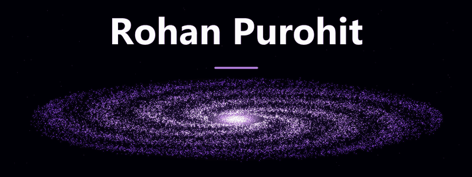
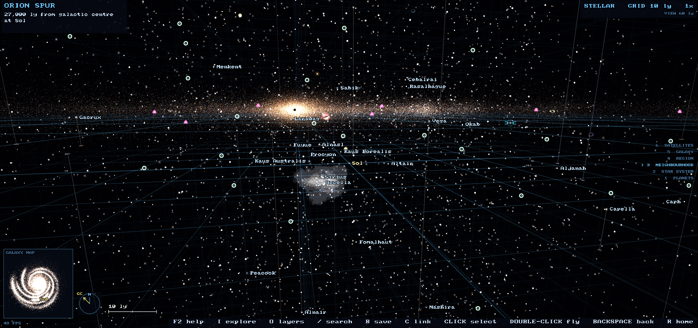
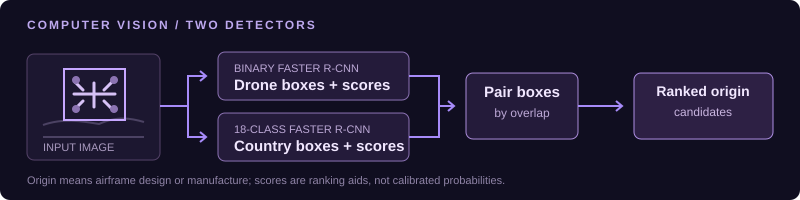
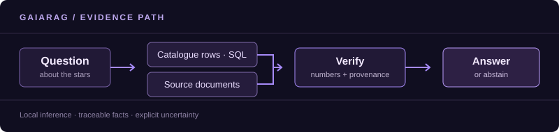

  

<strong>Trying to explore stuff, one step at a time.</strong>

  
  

<a href="https://github.com/ARPurohit07?tab=repositories">Browse all repositories →</a>

---

### Featured work

#### 01 / Milky Way Star Map &nbsp; `C++` `WebAssembly` `WebGL2`

**An explorable map of our stellar neighbourhood.** Catalogue-based star positions from HYG and Gaia sit within a procedural galaxy field. I brought the C++ renderer into the browser with WebAssembly and WebGL2, then added search and shareable views.

**[Explore the live map →](https://star-map-three.vercel.app)**

#### 02 / RocketRL &nbsp; `Python` `MuJoCo` `PPO`

**Teach a rocket to land in three dimensions.** A Pythia-70M-based PPO policy controls the engine and two steering axes in a MuJoCo simulation. The repository reports **373 landings in 400 untouched evaluation starts**, with separate development seeds used to select the checkpoint.

**[Explore RocketRL →](https://github.com/ARPurohit07/RocketRL)**

Simulation illustration. Code is public; model checkpoints currently require access to a private release.

#### 03 / Military Drone Detection &nbsp; `PyTorch` `Faster R-CNN` `Streamlit`

**Detect the drone; treat its origin as a hypothesis.** Two separate Faster R-CNN models locate drones and rank possible airframe design or manufacturing countries. Their boxes are paired by overlap, so uncertain origin labels cannot suppress a binary drone alert. Held-out testing reports **0.9503 mAP@0.5** for binary detection and documents false positives on unseen bird flocks.

**[See the models, evaluation, and limitations →](https://github.com/ARPurohit07/Military-Drone-Detection-System)**

Pipeline illustration. Datasets and model checkpoints are not included in the public repository.

#### 04 / GoodFlow &nbsp; `React` `TypeScript` `FastAPI` `Ollama`

**Turn a workflow image into a diagram you can actually edit.** Qwen2.5-VL reads the image locally. A React Flow canvas stays in sync with Mermaid text, and the result can be exported as Mermaid, SVG, PNG, or JSON.

**[View the open-source project →](https://github.com/ARPurohit07/GoodFlow)**

Workflow illustration; see the repository for the application.

#### 05 / GaiaRAG &nbsp; `Python` `DuckDB` `Ollama`

**Ask questions about the stars, with every number traceable to a catalogue row.** This companion to the star map combines SQL-backed catalogue facts with source documents. Deterministic checks catch unsupported numbers; when evidence is missing, the local system abstains.

**[Read the engineering notes and source →](https://github.com/ARPurohit07/GaiaRAG)**

---

<a href="https://github.com/ARPurohit07?tab=repositories">See the rest of my projects →</a>

